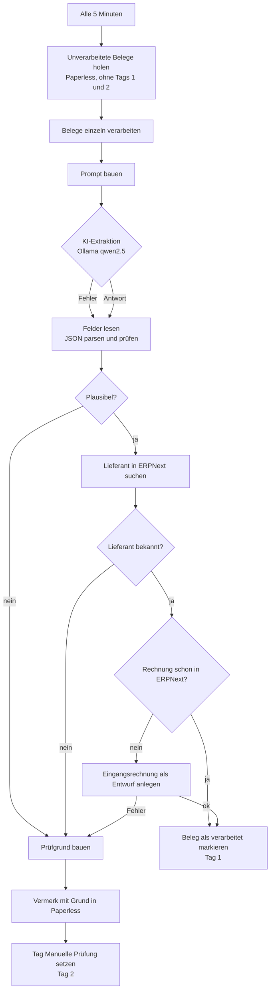

# n8n-Belegmanagement: Automatische Eingangsrechnungen in ERPNext

Dieses Repository enthält einen n8n-Workflow, der eingehende Belege aus einem Dokumentenarchiv liest, die Rechnungsdaten mit einem lokalen KI-Modell extrahiert und daraus einen **Entwurf** einer Eingangsrechnung in ERPNext anlegt. Gebucht wird nichts automatisch. Ein Mensch prüft und gibt jede Rechnung frei.

Die Erweiterung gegenüber der ersten Fassung: **Plausibilitätsprüfung, Fallback bei Fehlern und eine manuelle Prüfschleife mit Protokoll in Paperless.** Details siehe Abschnitt 3.

## Inhalt

1. [Kurzbeschreibung](#1-kurzbeschreibung)
2. [Ziel und Nutzen](#2-ziel-und-nutzen)
3. [Beschreibung der Erweiterung](#3-beschreibung-der-erweiterung)
4. [Ablauf des Workflows](#4-ablauf-des-workflows)
5. [Tools und KI-Modelle](#5-tools-und-ki-modelle)
6. [Daten](#6-daten)
7. [Integration im Unternehmen](#7-integration-im-unternehmen)
8. [Governance und Compliance](#8-governance-und-compliance)
9. [Risiken und Gegenmaßnahmen](#9-risiken-und-gegenmaßnahmen)
10. [Menschliche Kontrolle](#10-menschliche-kontrolle)
11. [Test und Erfolgsmessung](#11-test-und-erfolgsmessung)
12. [Installation und Nutzung](#12-installation-und-nutzung)
13. [Herausforderungen und Lernerfahrungen](#13-herausforderungen-und-lernerfahrungen)

Dateien im Repository:

| Datei | Inhalt |
| --- | --- |
| `workflow.json` | Exportierter n8n-Workflow, Hosts und Credentials sind Platzhalter |
| `tests/test-code-nodes.js` | Automatisierter Test der Logik in den Code-Nodes (ohne laufendes n8n) |
| `tests/testergebnis.txt` | Ausgabe des Tests mit den Beispielergebnissen |
| `README.md` | Diese Dokumentation |

---

## 1. Kurzbeschreibung

**Was der Workflow tut:** Alle 5 Minuten holt er bis zu 20 neue Belege aus Paperless-ngx, lässt ein lokales Sprachmodell (Ollama, `qwen2.5:7b`) die Felder Lieferant, Rechnungsnummer, Rechnungsdatum und Beträge auslesen, prüft Lieferant und Dubletten in ERPNext und legt eine Eingangsrechnung als Entwurf an.

**Welches Problem er löst:** Eingangsbelege werden meist von Hand in das ERP übertragen. Das kostet Zeit, führt zu Tippfehlern und kann dieselbe Rechnung doppelt erfassen. Der Workflow übernimmt die Routinearbeit und verhindert Dubletten.

## 2. Ziel und Nutzen

| Kennzahl | Ziel | Wie gemessen |
| --- | --- | --- |
| Bearbeitungszeit je Beleg | Gegenüber manueller Erfassung deutlich kürzer (noch nicht gemessen, siehe Abschnitt 11) | Stoppuhr-Stichprobe vor und nach Einführung |
| Fehlerquote in Beleg-Erfassung | Sinkt gegenüber manueller Erfassung | Stichprobe: Abgleich der Entwurfsfelder mit dem Originalbeleg |
| Dubletten | Keine doppelten Entwürfe | Abfrage in ERPNext nach Lieferant + Rechnungsnummer |
| Unbemerkt liegengebliebene Belege | Null | Alle Fehlerfälle erscheinen mit Vermerk in Paperless (Abschnitt 3) |
| Kosten | Keine Lizenzkosten für KI, keine Cloud-Gebühren pro Beleg | Lokaler Betrieb mit Ollama |

Die Erweiterung zielt vor allem auf **Qualität und Verlässlichkeit**: Vorher konnte ein fehlerhafter Beleg den Lauf still blockieren oder eine Rechnung ohne bekannten Lieferanten ins Leere schicken.

## 3. Beschreibung der Erweiterung

Die erste Fassung hatte drei Schwächen, die im Betrieb zu Problemen geführt hätten:

1. **Unbekannter Lieferant:** Der Workflow hatte nach der Prüfung „Lieferant vorhanden?“ beide Ausgänge auf denselben Folgeschritt gelegt. Ohne Lieferant ging der Entwurf trotzdem an ERPNext, wo er abgelehnt wird.
2. **Ungültige KI-Antwort:** Liefert das Modell kein gültiges JSON, bricht der Lauf ab. Der Beleg wird alle 5 Minuten erneut versucht und blockiert dabei die übrigen Belege.
3. **Keine Nachvollziehbarkeit:** Ein fehlgeschlagener Beleg war in Paperless nicht von einem unbearbeiteten zu unterscheiden.

Ergänzt wurde deshalb:

- **Plausibilitätsprüfung** (Node „Felder lesen“ und Verzweigung „Plausibel?“): Pflichtfelder vorhanden, Datum im Format `JJJJ-MM-TT`, Netto größer als null, Brutto nicht kleiner als Netto. Ist etwas davon verletzt, wird kein Entwurf angelegt.
- **Fallback bei KI-Fehlern:** Der Node „Ollama Extraktion“ leitet Fehler (Timeout, Modell nicht erreichbar) weiter, statt den Lauf abzubrechen. Ungültiges JSON wird im Code abgefangen.
- **Fehlerausgang bei ERPNext:** Lehnt ERPNext den Entwurf ab, geht der Beleg auf einen eigenen Ausgang. Er wird nicht als verarbeitet markiert.
- **Unbekannter Lieferant wird geprüft:** Die Verzweigung „Lieferant vorhanden?“ führt bei „nein“ jetzt in die manuelle Prüfung statt in die Rechnungsanlage.
- **Manuelle Prüfschleife:** Jeder Fehlerfall bekommt in Paperless einen **Vermerk mit dem Grund** (Notiz am Beleg) und das Tag **„Manuelle Prüfung“** (ID 2). Diese Belege werden nicht mehr automatisch verarbeitet, bis ein Mensch sie bearbeitet und das Tag entfernt.
- **Protokollierung:** Der Vermerk in Paperless ist das Protokoll für jeden Fehlerfall. Zusätzlich zeigt die n8n-Ausführungshistorie jeden Lauf.

Warum dieser Ansatz: Er nutzt nur Mittel, die der Workflow ohnehin hat (Paperless-API, n8n-Verzweigungen, Fehlerausgänge). Es kommt keine neue Software hinzu, und der Fehlerfall ist in dem System sichtbar, in dem die Belege ohnehin verwaltet werden.

## 4. Ablauf des Workflows



**Die einzelnen Schritte:**

1. **Start:** Alle 5 Minuten prüft der Workflow, ob neue Belege im Archiv liegen.
2. **Belege holen:** Bis zu 20 Belege ohne Tag „verarbeitet“ (ID 1) und ohne Tag „Manuelle Prüfung“ (ID 2) werden geladen.
3. **KI-Auswertung:** Das lokale Modell liest die Felder als JSON aus dem Belegtext. Fehler werden weitergereicht, nicht abgebrochen.
4. **Plausibilität:** Pflichtfelder, Datumsformat und Beträge werden geprüft. Bei Fehler: Schritt 8.
5. **Prüfung in ERPNext:** Der Lieferant wird gesucht. Fehlt er, geht es zu Schritt 8.
6. **Dublettenprüfung:** Existiert eine Rechnung mit gleichem Lieferanten und gleicher Nummer, wird der Beleg nur als verarbeitet markiert.
7. **Entwurf anlegen:** ERPNext erhält eine Eingangsrechnung als **Entwurf** mit 19 % Vorsteuer. Lehnt ERPNext ab, geht es zu Schritt 8.
8. **Fallback und Prüfschleife:** Grund ermitteln, Vermerk in Paperless schreiben, Tag „Manuelle Prüfung“ setzen. Der Beleg bleibt liegen, bis ein Mensch ihn bearbeitet.

**Screenshot:** Ein Screenshot des Workflows aus der n8n-Oberfläche ist noch nicht eingefügt. Er lässt sich nach dem Import über „Download“ bzw. das Kamerasymbol in n8n erzeugen und hier einbinden. Das Diagramm oben zeigt den Ablauf vollständig.

## 5. Tools und KI-Modelle

| Komponente | Rolle | Warum |
| --- | --- | --- |
| **n8n** | Orchestrierung, Zeitplan, Verzweigungen, Fehlerbehandlung | Visuell nachvollziehbar, Fehlerausgänge und Ausführungshistorie eingebaut, selbst hostbar |
| **Paperless-ngx** | Dokumentenarchiv, Quelle der Belege, Ort der Vermerke und Tags | Bereits im Einsatz für die Belegablage. Original bleibt unverändert |
| **Ollama** mit `qwen2.5:7b` | Lokale Feldextraktion aus dem Belegtext | Läuft auf eigener Hardware. Belegdaten verlassen das Haus nicht. Ein 7B-Modell ist für die Extraktion weniger Felder aus einem Textbeleg ein angemessener Umfang |
| **ERPNext** | Ziel der Eingangsrechnung als Entwurf | Vorhandenes ERP. Entwürfe lassen sich vor der Buchung prüfen |

**Warum ein lokales Modell statt einer Cloud-KI:** Belege enthalten Lieferantendaten, Bankverbindungen und Beträge. Ein lokales Modell vermeidet eine Drittlandübermittlung und einen Auftragsverarbeiter für diesen Schritt. Der Nachteil ist eine etwas geringere Erkennungsgüte bei sehr schlechten Scans. Diesen Fall fängt die Plausibilitätsprüfung ab.

**Warum Ausgabe im festen JSON-Format:** Das Modell darf nur die fünf Felder liefern. Es entsteht kein freier Text, der weiterverarbeitet werden könnte. Das begrenzt Halluzinationen und Prompt-Injection durch Belegtext.

## 6. Daten

| Datum | Verarbeitung | Personenbezug | Vertraulichkeit |
| --- | --- | --- | --- |
| Lieferantenname | Lesen, Abgleich mit ERPNext, Entwurf | Ja, wenn Einzelunternehmer oder Freiberufler | Gering bis mittel |
| Rechnungsnummer, Datum | Lesen, Dublettenprüfung | Nein, aber zuordenbar | Gering |
| Netto- und Bruttobetrag | Lesen, Plausibilität, Entwurf | Indirekt | Mittel (Geschäftsdaten) |
| Belegtext als Ganzes | An das lokale Modell übergeben | Ja: Adressen, ggf. Bankverbindung, Telefonnummern | Mittel bis hoch |
| Vermerke und Tags in Paperless | Schreiben | Enthält den Grund, nicht den Belegtext | Gering |

- Verarbeitet werden **echte Belegdaten**. Sie sind personenbezogen und vertraulich, sobald ein Lieferant eine natürliche Person ist oder der Beleg Bankdaten enthält.
- **Die Testdaten in diesem Repository sind fiktiv.** Die Namen und Nummern im Test sind erfunden.
- Die Daten bleiben auf den eigenen Servern: Paperless, Ollama, n8n und ERPNext laufen im Haus oder in einer Umgebung, für die ein Auftragsverarbeitungsvertrag besteht.
- Die n8n-Ausführungshistorie speichert die verarbeiteten Belegtexte. Die Aufbewahrungsdauer muss deshalb gesetzt werden (siehe Abschnitt 8).

## 7. Integration im Unternehmen

**Technische Voraussetzungen**

- n8n (ab Version 1.x, mit HTTP-Request-Node ab Version 4.5 und Fehlerausgängen)
- Paperless-ngx mit API-Zugriff und zwei Tags: „verarbeitet“ (ID 1) und „Manuelle Prüfung“ (ID 2)
- Ollama mit geladenem Modell `qwen2.5:7b`, mit ausreichend Arbeitsspeicher. Die Antwortzeit kann bei großen Belegen einige Minuten betragen; das Timeout ist auf 5 Minuten gesetzt.
- ERPNext mit API-Zugriff und einem **eigenen Integrationsbenutzer**, der nur Eingangsrechnungen anlegen und lesen darf. Keine Freigabe- oder Buchungsrechte.
- Ein Konto oder Kostenstellen-Mapping in ERPNext, das zu den fest eingetragenen Konten im Workflow passt (Abschnitt 12).

**Organisatorische Voraussetzungen**

| Rolle | Verantwortung |
| --- | --- |
| **Fachverantwortung Buchhaltung** | Prüft und gibt Entwürfe frei, bearbeitet die Prüffälle, legt fest, was als Fehler gilt |
| **IT-Betrieb** | Betreibt n8n, Paperless, Ollama und ERPNext, pflegt Zugangsdaten, sichert Backups, überwacht Fehlerausführungen |
| **Workflow-Verantwortliche/r** | Pflegt den Workflow, testet nach jeder Änderung, führt die Stichproben durch, dokumentiert Änderungen |
| **Datenschutzbeauftragte/r** | Prüft Verarbeitungsverzeichnis und Aufbewahrung, gibt den Einsatz frei |
| **Betriebsrat** (falls vorhanden) | Wird vor Einführung beteiligt, wenn Auswertungen zu Mitarbeitenden möglich sind (Abschnitt 8) |

Vor dem produktiven Einsatz sollte ein benannter Verantwortlicher je Rolle feststehen, und die Freigabe sollte schriftlich erfolgen.

## 8. Governance und Compliance

**Datenschutz (DSGVO)**

- **Rechtsgrundlage:** Die Verarbeitung dient der Buchführung und ist durch gesetzliche Pflichten gedeckt (Art. 6 Abs. 1 lit. c DSGVO in Verbindung mit den Aufbewahrungspflichten). Die Rechtsgrundlage ist vom Datenschutzbeauftragten zu bestätigen.
- **Verarbeitungsverzeichnis (Art. 30):** Der Workflow ist als eigener Verarbeitungsvorgang einzutragen.
- **Keine Drittlandübermittlung:** Das KI-Modell läuft lokal. Falls die Umgebung gewechselt wird (etwa auf eine Cloud-API), gelten Art. 28 (Auftragsverarbeitung) und Art. 44 ff. (Drittlandübermittlung) ausdrücklich. Das wäre eine neue Bewertung.
- **Betroffenenrechte:** Auskunft und Löschung betreffen die Belegdaten in Paperless, ERPNext und in der n8n-Ausführungshistorie. Alle drei Stellen müssen im Löschprozess berücksichtigt werden.
- **Automatisierte Entscheidung (Art. 22):** Es gibt keine rechtlich wirksame automatische Entscheidung, weil jeder Entwurf von einem Menschen freigegeben wird. Diese Voraussetzung muss bestehen bleiben. Wird die Freigabe entfernt, ist die Bewertung neu vorzunehmen.

**Aufbewahrung und Ordnungsmäßigkeit (GoBD, § 147 AO)**

- Buchungsbelege sind in der Regel **zehn Jahre** aufzubewahren. Das Original bleibt in Paperless unverändert, der Entwurf in ERPNext ist die Erfassung, nicht der Beleg.
- Die Vermerke und Tags in Paperless sind **Prozessprotokoll**. Sie dürfen nicht gelöscht werden, solange der Beleg aufbewahrt wird.
- Die n8n-Ausführungshistorie sollte auf die Dauer begrenzt werden, die für Fehlersuche nötig ist (z. B. 30 Tage), statt sie unbegrenzt zu speichern. Das reduziert die Datenmenge und das Löschproblem.

**EU AI Act**

- Der Einsatz ist eine **Assistenzfunktion ohne Entscheidung**: Die KI extrahiert Felder, ein Mensch entscheidet. Nach aktuellem Verständnis fällt das nicht in eine Hochrisiko-Kategorie des Anhangs III. Dies ist vom Datenschutz- und Rechtsbereich zu bestätigen.
- **KI-Kompetenz (Art. 4):** Die Personen, die Entwürfe prüfen, müssen wissen, dass die Angaben von einem KI-Modell stammen und fehleranfällig sind. Dazu gehört eine kurze Schulung.
- **Transparenz:** Im ERP-Entwurf sollte ein Hinweis stehen, dass die Daten KI-gestützt erfasst wurden. Das ist ein kleiner Zusatz im Feld „Bemerkungen“ und noch nicht umgesetzt.

**Informationssicherheit**

- Zugangsdaten nur in der n8n-Credential-Verwaltung, nie im Repository (siehe Abschnitt 12).
- Eigene Benutzer mit minimalen Rechten für Paperless und ERPNext.
- n8n und Ollama nur im internen Netz erreichbar, kein Zugriff aus dem Internet.
- Regelmäßige Backups der n8n-Workflows und der Paperless-Datenbank.

**Urheberrecht und Lizenzen**

- Das Modell `qwen2.5:7b` wird unter den Lizenzbedingungen des Herausgebers verwendet. Vor dem Produktiveinsatz sind die Lizenzbedingungen des konkreten Modells und der genutzten Version zu prüfen.
- n8n, Paperless-ngx, Ollama und ERPNext unterliegen ihren jeweiligen Open-Source-Lizenzen. Für den Betrieb im Unternehmen ist zu prüfen, ob die Lizenzen für den geplanten Einsatz passen (z. B. n8n bietet unterschiedliche Lizenzmodelle).
- Der Workflow selbst liegt unter der Lizenz, die das Repository trägt (siehe Abschnitt Lizenz unten).

**Mitbestimmung**

- Der Workflow verarbeitet Belege, keine Leistungsdaten von Mitarbeitenden. Er wird aber nur dann unbedenklich, wenn die Protokolle nicht zur Leistungskontrolle genutzt werden. Die Vermerke in Paperless enthalten Benutzerkennungen, sobald Paperless sie speichert.
- Vor Einführung ist zu prüfen, ob eine Betriebsvereinbarung nach § 87 Abs. 1 Nr. 6 BetrVG nötig ist.

**Interne Richtlinien**

- Der Einsatz ist zu dokumentieren: Zweck, Verantwortliche, Datenarten, Modell, Änderungsverlauf.
- Neue Versionen des Workflows nur nach Test und Freigabe produktiv schalten.

## 9. Risiken und Gegenmaßnahmen

| Risiko | Art | Gegenmaßnahme |
| --- | --- | --- |
| KI liest Betrag oder Nummer falsch | Fachlich | Entwurf wird vor Freigabe geprüft. Stichprobe (Abschnitt 11). Plausibilität prüft Beträge und Datum |
| Dublette einer Rechnung | Fachlich | Prüfung nach Lieferant und Rechnungsnummer vor dem Anlegen |
| Unbekannter Lieferant oder Namensvariante | Fachlich | Kein Entwurf ohne bekannten Lieferanten, stattdessen Prüffall mit Vermerk |
| Modell antwortet nicht oder ungültig | Technisch | Fehlerausgang und Prüffall statt Abbruch. Timeout 5 Minuten |
| Belegtext enthält Anweisungen an die KI (Prompt-Injection) | Technisch | Feste Felder, nur JSON-Ausgabe, keine Aktion außer Entwurf. Ein Mensch prüft jeden Entwurf |
| Falsches Konto oder falscher Steuersatz | Fachlich | Konten sind fest vorgegeben und müssen zum Kontenplan passen. Buchhaltung prüft bei Einrichtung und in Stichproben |
| ERPNext oder Paperless fällt aus | Betrieblich | Lauf schlägt fehl, Belege bleiben unverändert und werden beim nächsten Lauf erneut versucht. Fehlerbenachrichtigung in n8n einrichten |
| Zugangsdaten gelangen in das Repository | Sicherheit | Nur Platzhalter in `workflow.json`. Echte Werte nur in n8n-Credentials |
| Belegdaten gelangen nach außen | Datenschutz | Lokales Modell, interne Dienste, keine Cloud-Aufrufe |
| Überlange Aufbewahrung der Ausführungsdaten | Datenschutz | Ausführungshistorie begrenzen (z. B. 30 Tage) |
| Abhängigkeit von einer Person | Organisatorisch | Rollen und Vertretung festlegen, Dokumentation pflegen |
| Modellwechsel verändert Ergebnisse | Fachlich | Nach jedem Modellwechsel Stichprobe und Testlauf wiederholen |

## 10. Menschliche Kontrolle

Diese Ergebnisse oder Aktionen müssen durch einen Menschen geprüft oder freigegeben werden:

1. **Jeder Entwurf in ERPNext** wird geprüft und erst dann gebucht. Der Workflow bucht nie selbst.
2. **Jeder Prüffall** (Tag „Manuelle Prüfung“ in Paperless) wird bearbeitet. Der Grund steht im Vermerk am Beleg.
3. **Stichproben:** Die Buchhaltung prüft wöchentlich einen festen Anteil der automatisch angelegten Entwürfe (Vorschlag: 10 %, mindestens 5 Belege) gegen das Original. Ergebnisse werden protokolliert.
4. **Neue Lieferanten:** Der erste Entwurf eines neuen Lieferanten wird immer vollständig geprüft.
5. **Änderungen am Workflow** (Konten, Steuersatz, Prompt, Modell) werden nur nach Test und Freigabe durch die Fachverantwortung produktiv geschaltet.
6. **Vorsteuer:** Der Workflow setzt 19 % fest. Belege mit ermäßigtem Satz oder ohne Vorsteuer sind manuell zu prüfen. Der Workflow erkennt das derzeit nicht selbst.

## 11. Test und Erfolgsmessung

### Was getestet wurde

**a) Automatisierter Logiktest** (`tests/test-code-nodes.js`). Er führt die Logik der geänderten Code-Nodes mit Beispieldaten aus, ohne n8n zu starten. Er prüft:

- gültige Antwort wird übernommen,
- kein JSON, leere Antwort, Ollama-Fehler werden abgefangen,
- fehlende Pflichtfelder, falsches Datum, unplausible Beträge werden erkannt,
- unbekannter Lieferant, ERPNext-Fehler und Plausibilitätsfehler erzeugen den passenden Vermerk.

**b) Struktur des Workflows:** Alle Verbindungen zeigen auf vorhandene Nodes, alle Nodes sind vom Startknoten erreichbar, Node-IDs sind eindeutig. Dies wurde mit einem Skript geprüft.

**c) Noch offen:** Ein Durchlauf des kompletten Workflows in einer laufenden n8n-Instanz mit echtem Paperless, Ollama und ERPNext. Das konnte in dieser Umgebung nicht ausgeführt werden. Vor dem produktiven Einsatz ist er Pflicht (Checkliste unten).

### Testnachweis (Beispielergebnisse)

Ausgabe von `node tests/test-code-nodes.js`, Datei `tests/testergebnis.txt`:

```text
PASS  1 gültige KI-Antwort
PASS  2 kein JSON (KI schreibt Freitext)
PASS  3 Ollama-Fehler (continueOnFail, kein response)
PASS  4 Lieferant und Nummer fehlen
PASS  5 Datum falsches Format
PASS  6 Brutto kleiner als Netto
PASS  7 JSON-null
PASS  8 Lieferant unbekannt
PASS  9 ERPNext lehnt ab (Error-Ausgang)
PASS  10 Plausibilität fehlgeschlagen
PASS  11 Vermerk-Body ist gültiges JSON mit note

Alle 11 Fälle bestanden.
```

### Checkliste für den Test in n8n (vor dem Produktivbetrieb)

- [ ] Workflow importieren, Platzhalter ersetzen, Credentials zuweisen
- [ ] Testbeleg mit gültigen Daten in Paperless legen, manuell starten: Entwurf in ERPNext entsteht, Beleg hat Tag 1
- [ ] Gleichen Beleg erneut starten: **kein** zweiter Entwurf (Dublettenprüfung)
- [ ] Beleg mit unbekanntem Lieferanten: kein Entwurf, Vermerk „ist in ERPNext nicht angelegt“, Tag 2
- [ ] Ollama stoppen, Beleg starten: kein Abbruch, Prüffall mit Grund „KI-Auswertung fehlgeschlagen“
- [ ] Ungültigen Beleg (Datum falsch) prüfen: Prüffall
- [ ] Prüfen, ob die Abfrage `tags__id__none=1,2` in Paperless alle Belege ohne Tag 1 und 2 liefert
- [ ] Stichprobe von zehn Entwürfen gegen die Originale vergleichen

### Erfolgsmessung

Nach zwei bis vier Wochen im Pilotbetrieb auswerten:

- **Fehlerquote** der Entwürfe in der Stichprobe (falsche Felder je Beleg)
- **Prüffallquote** (Anteil der Belege mit Tag 2). Ein hoher Anteil heißt, das Modell passt nicht zu den Belegen. Ein sehr niedriger Anteil kann heißen, dass die Plausibilität zu wenig prüft.
- **Dubletten** in ERPNext: Erwartung null
- **Zeit je Beleg** vor und nach der Einführung

Erst wenn Fehlerquote und Prüffallquote über den Pilotzeitraum stabil sind, sollte der Umfang erweitert werden.

---

## 12. Installation und Nutzung

### Voraussetzungen

- n8n ab Version 1.x
- Paperless-ngx mit API-Token für einen Benutzer mit Leserechten und Tag-Rechten
- Zwei Tags in Paperless: „verarbeitet“ mit **ID 1** und „Manuelle Prüfung“ mit **ID 2**. Die IDs stehen im Code und in der Abfrage fest. Wenn Ihre IDs anders sind, müssen `tags__id__none=1,2`, `tag: 1` und `tag: 2` angepasst werden.
- Ollama mit `qwen2.5:7b`
- ERPNext mit API-Schlüssel eines Integrationsbenutzers (nur Eingangsrechnungen anlegen und lesen)

### Einrichtung

1. Modell laden: `ollama pull qwen2.5:7b`
2. In n8n die Datei `workflow.json` importieren.
3. Platzhalter ersetzen:
   - `PAPERLESS_HOST`, `ERPNEXT_HOST`, `OLLAMA_HOST`: eigene Adressen der Dienste (Adressen nur im internen Netz)
   - `REPLACE_CREDENTIAL_ID`: in n8n Credentials vom Typ **Header Auth** anlegen und zuweisen:
     - **Paperless API**: Header `Authorization`, Wert `Token <eigener Paperless-Token>`
     - **ERPNext API**: Header `Authorization`, Wert `token <API-Key>:<API-Secret>` des Integrationsbenutzers
   - Je Dienst ein eigenes Credential anlegen
4. Konten an die eigene ERPNext-Installation anpassen. Im Node „Eingangsrechnung bauen“ stehen fest:
   - Aufwandskonto `5130 - Einkauf Roh-, Hilfs- und Betriebsstoffe 19% Vorsteuer - S`
   - Vorsteuerkonto `1406 - Abziehbare Vorsteuer 19 % - S`
   - Firma `DEMO_FIRMA` und Artikel `DEMO-LEISTUNG`
   Diese Namen müssen in ERPNext existieren, sonst lehnt ERPNext den Entwurf ab. Der Fehlerpfad fängt das ab und legt einen Prüffall an.
5. Tags in Paperless prüfen (IDs 1 und 2, siehe oben).
6. Testlauf nach der Checkliste in Abschnitt 11 durchführen.
7. Workflow aktivieren.

### Nutzung im Alltag

- Neue Belege in Paperless ablegen. Der Workflow holt sie innerhalb von 5 Minuten.
- Entwürfe in ERPNext prüfen und buchen.
- Prüffälle in Paperless öffnen, den Vermerk lesen, den Beleg korrigieren oder manuell erfassen. Danach das Tag „Manuelle Prüfung“ entfernen. Solange das Tag gesetzt ist, verarbeitet der Workflow den Beleg nicht. Ist es entfernt, nimmt er ihn beim nächsten Lauf wieder auf, sofern der Beleg kein Tag „verarbeitet“ trägt.

---

## 13. Herausforderungen und Lernerfahrungen

[Bitte ergänzen: Welche Probleme gab es? Zum Beispiel beim Parsen des JSON aus der KI-Antwort, bei Duplikaten, bei Netzwerkzugriffen zwischen Containern oder beim Zuordnen der Konten in ERPNext.]

[Bitte ergänzen: Was habt ihr gelernt? Zum Beispiel den Umgang mit lokaler KI, Zeitpläne in n8n, Duplikatsprüfung oder die Trennung von Entwurf und Buchung.]

---

## Lizenz

Die Lizenz dieses Repositories ist noch festzulegen. Bis dahin gelten alle Rechte beim Autor.
