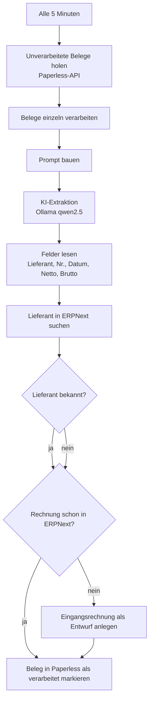

# n8n-Belegmanagement: Automatische Eingangsrechnungen in ERPNext

## Projektname

**Belegmanagement mit n8n, lokaler KI und ERPNext**

## Projektziel

Eingehende Belege sollen nicht mehr von Hand in die Buchhaltung übertragen werden. Ein Workflow liest neue Belege aus einem Dokumentenarchiv aus, extrahiert die wichtigsten Rechnungsdaten und legt daraus einen **Entwurf** einer Eingangsrechnung in ERPNext an. Gebucht wird nichts automatisch. Ein Mensch prüft und gibt die Rechnung frei.

## Kurze Beschreibung des Problems

Belege kommen als PDF oder Scan an und müssen Lieferant, Rechnungsnummer, Datum und Beträge enthalten. Diese Daten werden meist manuell abgetippt. Das kostet Zeit und führt zu Fehlern. Außerdem kann dieselbe Rechnung zweimal erfasst werden. Der Workflow soll die Routinearbeit übernehmen und Dubletten verhindern.

## Verwendete Tools

- **n8n**: Workflow-Automatisierung, läuft als Zeitplan alle 5 Minuten
- **Paperless-ngx**: Dokumentenarchiv, aus dem die Belege geholt werden
- **Ollama** mit dem Modell `qwen2.5:7b`: lokale KI zur Feldextraktion, keine Cloud
- **ERPNext**: ERP-System, in dem die Eingangsrechnung als Entwurf angelegt wird

## Workflow

**Die einzelnen Schritte:**

1. **Start:** Alle 5 Minuten prüft der Workflow, ob neue Belege im Archiv liegen.
2. **Belege holen:** Bis zu 20 Belege, die noch keine Verarbeitungs-Markierung tragen, werden aus Paperless geladen und einzeln bearbeitet.
3. **KI-Auswertung:** Das lokale Modell liest Lieferant, Rechnungsnummer, Rechnungsdatum und Beträge als JSON aus dem Belegtext.
4. **Prüfung in ERPNext:** Der Workflow sucht den Lieferanten und prüft, ob eine Rechnung mit derselben Nummer und demselben Lieferanten bereits existiert.
5. **Entwurf anlegen:** Fehlt die Rechnung, legt ERPNext eine Eingangsrechnung als Entwurf mit 19 % Vorsteuer an.
6. **Abschluss:** Der Beleg wird in Paperless als verarbeitet markiert und nicht erneut verarbeitet.

Die Schritte 4 und 5 sind so gebaut, dass dieselbe Rechnung nicht zweimal als Entwurf entsteht.

## Screenshots

> **Platzhalter:** Hier die Screenshots einfügen. Dazu den Workflow in n8n öffnen und ein Bild davon machen. Bild direkt in dieses Dokument ziehen, GitHub erzeugt dann den Link automatisch.

- `[Screenshot: Workflow-Übersicht in n8n]`
- `[Screenshot: Ergebnis-Eingangsrechnung als Entwurf in ERPNext]`

## Dateien im Repository

| Datei | Inhalt |
| --- | --- |
| `workflow.json` | Exportierter n8n-Workflow mit Platzhaltern für Hosts und Credentials |
| `README.md` | Diese Dokumentation |

## Einrichtung

1. In n8n die Datei `workflow.json` importieren.
2. Platzhalter ersetzen:
   - `PAPERLESS_HOST`, `ERPNEXT_HOST`, `OLLAMA_HOST`: eigene Adressen der Dienste
   - `REPLACE_CREDENTIAL_ID`: eigene Credentials in n8n anlegen und zuweisen (Typ: Header Auth, Paperless API und ERPNext API)
   - Firmen- und Kontonamen in den Code-Nodes an die eigene ERPNext-Installation anpassen
3. Modell in Ollama laden: `ollama pull qwen2.5:7b`
4. Workflow aktivieren.

## Herausforderungen

[Bitte ergänzen: Welche Probleme gab es? Zum Beispiel beim Parsen des JSON aus der KI-Antwort, bei Duplikaten, bei Netzwerkzugriffen zwischen Containern oder beim Zuordnen der Konten in ERPNext.]

## Lernerfahrungen

[Bitte ergänzen: Was habt ihr gelernt? Zum Beispiel den Umgang mit lokaler KI, Zeitpläne in n8n, Duplikatsprüfung oder die Trennung von Entwurf und Buchung.]
